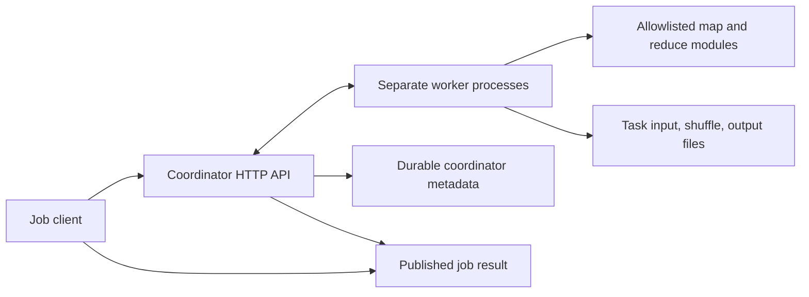
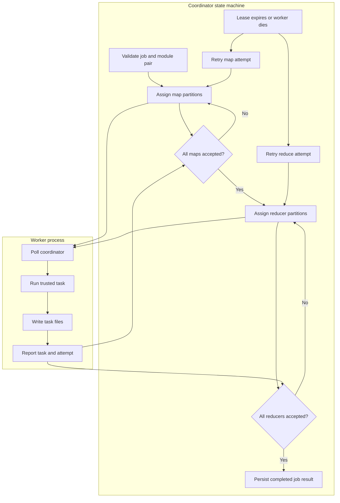

# MapReduce runtime

## Guide

- [Architecture and execution guide](#architecture-and-execution-guide)
- [Verification and evidence](#verification-and-evidence)
- [Reproducible benchmark](#reproducible-benchmark)
- [Sources and scope](#sources-and-scope)

A small, dependency-free MapReduce engine using separate Node worker processes and loopback HTTP. It partitions input records, maps on workers, hashes intermediate keys into reducer partitions, transfers partitions over HTTP, groups and sorts keys, and reduces on workers. Inputs, worker files, accepted attempts and final output survive process cleanup.

This is an original educational implementation informed by Brown's distributed processing milestone and the MapReduce paper. No finished student solution was copied, and this is not a drop-in implementation of Brown's distribution library. The public project name is **MapReduce runtime**; the original local checkout directory may be named `rillmap`.

## Run

Use Node 25+ on Windows or Linux; there are no packages to install, cloud accounts, external datasets or GPU requirements.

```powershell
npm run check
npm test
```

The verification driver creates its own coordinator and workers, checks their real HTTP API, captures evidence in `.runs/<timestamp>/`, and stops only its own child processes. Evidence survives cleanup. `npm test` returns nonzero on failure. The workflow runs these same commands on Linux and Windows; local validation has been performed on Windows with Node 25.8.1. Hosted CI has not yet run.

For an interactive run, set the same secret in each terminal, then launch the coordinator and two or more workers. Each worker needs its own data directory. Generate a fresh token for your own run rather than reusing this illustrative one.

```powershell
$env:MAPREDUCE_TOKEN = 'local-example-token-change-me'
node src/coordinator.mjs --data data/coordinator --port 8080 --lease 10000
```

```powershell
$env:MAPREDUCE_TOKEN = 'local-example-token-change-me'
node src/worker.mjs --url http://127.0.0.1:8080 --id worker-1 --data data/worker-1
```

In a third terminal, use a distinct ID and directory for a second worker. Submit input and inspect the result in another terminal:

```powershell
$headers = @{ Authorization = "Bearer $env:MAPREDUCE_TOKEN" }
$body = @{ module = 'wordcount'; keys = @(@('doc-1','a b a'), @('doc-2','b c')); splits = 3; reducers = 2 } | ConvertTo-Json -Depth 8
$job = Invoke-RestMethod http://127.0.0.1:8080/jobs -Method Post -Headers $headers -ContentType application/json -Body $body
Invoke-RestMethod "http://127.0.0.1:8080/jobs/$($job.id)" -Headers $headers
```

Poll until `status` is `done`; `output` is `[["a",2],["b",2],["c",1]]`. Set `MAPREDUCE_TOKEN` in the submission terminal too. Stop each owned process with Ctrl+C. Restart the coordinator with its original data directory and token to resume unfinished jobs.

## Custom jobs

Place trusted local modules in `jobs/<name>.mjs` on the coordinator and all workers. Names match `[a-z][a-z0-9-]{0,63}`. Modules export `map(key, value)` returning an array of `[stringKey, JSONValue]` pairs and `reduce(key, values)` returning one JSON value. Either function may be async. The framework routes any valid job module; it does not dispatch on a hardcoded word-count operation. For example:

```js
export const map = (_key, reading) => [[reading.category, reading.amount]];
export const reduce = (_key, values) => values.reduce((sum, n) => sum + n, 0);
```

Functions must be deterministic and free of external effects. Retries may execute them multiple times; only accepted output publication is idempotent. Return JSON-safe values (no undefined, functions, nonfinite numbers, BigInt or cycles). Keep modules identical and unchanged across workers and coordinator restarts; module code is loaded locally, never evaluated from HTTP input. No sandbox is claimed for trusted job modules.

Bundled jobs demonstrate word count, maximum temperature per station (including negative readings), inverted index, and an intentionally delayed count used for controlled recovery verification. Duplicate input keys are preserved as independent records; inverted index explicitly deduplicates document IDs.

## Mechanisms

| Requirement | Implementation |
| --- | --- |
| Input partitioning | Coordinator stores round-robin splits; workers fetch their assigned split via HTTP and store a local copy. |
| Distributed map | Independently scheduled child processes execute the local module's map function. |
| Shuffle | Each worker hashes each intermediate key with SHA-256's first unsigned 32 bits modulo reducer count. The coordinator stores the accepted array of buckets. Each reducer fetches its bucket from every accepted map over HTTP. |
| Group and sort | Reducer groups all values by exact string key and processes keys in locale comparison order. Final pairs are sorted the same way. |
| Barriers | No reducer is assigned until every map has a durable accepted publication. Results appear only after every reducer has published. |
| Durable artifacts | `inputs/<job>/<split>.json`, `attempts/<token>.json`, `results/<job>.json`, `jobs/<job>.json` under the coordinator directory; per-attempt input/shuffle/output files under worker directories. Legacy `state.json` is imported and preserved. |
| Attempts and recovery | A claim creates a UUID token and fixed lease, increments the task's attempt count and persists before responding. An expired task is eligible for reassignment when a worker next polls. Four failed/expired attempts fail the job. |
| Fencing and idempotence | Completion must match current phase, task, token and unexpired lease. An accepted token replay acknowledges without a second publication. Obsolete tokens receive HTTP 409. |
| Coordinator restart extension | Persisted running tasks reset to pending before the server listens. A new lease always gets a new UUID; pre-restart completions cannot publish. Accepted tasks and final results are retained. |

After per-job metadata import, reopen the data directory with this version or newer. Older releases do not understand authoritative `jobs/<UUID>.json` snapshots; the preserved legacy file is an import source, not a current registry for downgrade.

The coordinator serializes mutations in one event loop. It writes the changed job's temporary JSON file, flushes it and renames it before responding. Attempts and final output are written before the job snapshot referencing them. A crash before a metadata commit may leave unused files, which recovery ignores; a crash after commit retains the accepted attempt. On startup it imports legacy `state.json`, overlays authoritative `jobs/<UUID>.json` snapshots and persists reset running leases before listening. The original legacy file remains intact; partial import cannot override a newer job snapshot with a stale legacy lease. Invalid metadata filenames, ID mismatches and corrupt snapshots refuse startup. Persistence errors stop the coordinator rather than serving mutated, uncommitted state. There is one coordinator per canonical data directory. An OS-owned IPC endpoint serializes startup before any PID-file reclamation. Windows uses a named pipe and Linux uses an abstract Unix socket; the OS releases ownership when the process exits. The PID file remains diagnostic metadata and a compatibility check for older coordinators. Simultaneous restart verification launches four contenders and requires exactly one owner.

## API and limits

All routes require `Authorization: Bearer <MAPREDUCE_TOKEN>`, with a token of at least 16 characters. The coordinator binds only `127.0.0.1`; workers require a loopback coordinator.

| Route | Purpose |
| --- | --- |
| `GET /health` | PID/version readiness and ownership check |
| `POST /jobs` | `{module, keys: [[key,value],...], splits?, reducers?}` → `{id}` |
| `GET /jobs/:id` | Task attempts, events, status and final output |
| `POST /claim` | `{worker}` → task lease or `null` |
| `GET /jobs/:id/input/:split` | Stored input split |
| `GET /jobs/:id/shuffle/:map/:partition` | Accepted map bucket, after map barrier |
| `POST /jobs/:id/complete` | `{phase,index,token,output}` or `{phase,index,token,error}` |

JSON numbers must be finite. The shared encoder validates numbers before HTTP serialization and persistence, and incoming JSON is checked before any state change. Input keys are strings of at most 4096 characters. Each pair list allows at most 100,000 records, each request body at most 4 MiB, and split/reducer counts are 1–64. HTTP calls time out after 5 seconds; server request/header timeouts are 10 seconds. Default task leases are 10 seconds, configurable from 100 ms to 10 minutes. There are no heartbeats: a task must finish within its lease. A trusted module that blocks a worker indefinitely cannot block coordinator reassignment, but its original worker process must be stopped by its owner. Retry limits do not cancel JavaScript already executing.

This local prototype keeps coordinator metadata and all accepted shuffle data on one disk. It demonstrates distributed execution and network shuffle on one host, not distributed storage replication or multi-host deployment. Memory use is bounded per request, not across accumulated jobs: reduce groups, JSON artifacts and job metadata are materialized in memory. There is no garbage collector, streaming spill, combiner, speculative scheduling, iterative API, fairness guarantee, admission control or replicated coordinator. Keep local workloads small and retain storage deliberately. Failed job inputs and orphan temporary/attempt files remain for diagnosis.

Atomic rename and file flush are exercised for process crashes, not power failure or disk loss; directory flushes and storage hardware guarantees are not established. A PID reused by an unrelated process can conservatively prevent startup. Do not remove an owner file while its process is alive. The shared token authenticates trusted local participants and grants access to all jobs; there is no tenant isolation or TLS. Remote use requires a separate security and storage design.

## Verification and evidence

The maintained [verification skill](.agents/skills/verify-rillmap/SKILL.md) describes Launch, Doctor, Drive, Evidence and Cleanup. `tools/verify.mjs` checks:

- Three separate workers against independent sequential word-count, maximum-temperature and inverted-index oracles, including empty inputs, skew and repeated input keys.
- Worker death during an assigned task, observed expiry, reassignment and one accepted output per task.
- Coordinator death during an active lease, restart with surviving workers, correct final result and rejection of a stale completion.
- Duplicate accepted map and reduce completion with no duplicate publication; API outputs equal durable result files; worker input, shuffle and output files exist.
- Unauthorized requests, invalid module paths/pairs/null bodies, prototype-key lookup, map barrier enforcement, exclusive coordinator ownership and four-attempt failure for invalid temperature data.

The driver records actions and assertions in `.runs/<timestamp>/evidence.json`, logs each owned process, retains all durable artifacts, and confirms evidence survives cleanup. This is an executable correctness/recovery check, not a throughput or scale benchmark.

## Reproducible benchmark

The [frozen benchmark driver](.agents/skills/verify-rillmap/features/benchmark.md) measures real HTTP jobs with separate worker processes and exact independent durable-result checks. Run `node --test tools/benchmark.test.mjs` and `node tools/benchmark.mjs smoke` for a short correctness check. Run `node tools/benchmark.mjs benchmark` on an isolated Linux runner for five-repeat worker/data/skew comparisons, offered-load sweeps, a stability run and observed worker loss. `node tools/benchmark.mjs profile` is a separate diagnostic campaign. The manual `Benchmark` workflow retains raw receipts under `.runs/benchmark-*/` with source, machine, input hashes, outcomes, scheduled-arrival latency, shuffle bytes and CPU/RSS samples. Read the feature page for frozen cells and limitations.

The [initial hosted measurements](docs/benchmarks/2026-10-22-initial.md) retain all raw receipts and limitations. Source `a056f48` completed 960 of 960 offered jobs at 8 jobs/s for 120 seconds, with exact word-count and durable-result checks, no declines or errors, and p50/p95/p99 latency of 116.0 / 168.5 / 180.4 ms. An earlier run finished 522 of 960 jobs and declined 438. Profiling identified full-registry durable saves as the limiter; the fix writes per-job atomic snapshots. Both runs exposed four cores, but CPU models differed, so no exact speedup ratio is claimed. The report gives all twelve five-repeat data/skew/worker cells, median and range, CPU/RSS, commands, hashes and remaining limits.

## Sources and scope

- [Brown CS1380/1385/2380 milestones (2026)](https://cs.brown.edu/courses/csci1380/milestones/) and [M5: Distributed Processing](https://docs.google.com/document/d/e/2PACX-1vSE-N3JJT-zJ9SUTuWJkxvNlEmRgCKNG004SZxwnxWRTTUCTq353FKV4XdTygiDTwvtS8Vd8w6_ucfQ/pub) supply the coursework context: map/reduce abstractions, phase coordination, shuffling and the example scenarios. This project substitutes named trusted modules and JSON pairs for serialized function objects and the course's distributed key-value API; it does not implement every optional extension or claim course grader compatibility.
- Jeffrey Dean and Sanjay Ghemawat, [MapReduce: Simplified Data Processing on Large Clusters, OSDI 2004](https://research.google/pubs/mapreduce-simplified-data-processing-on-large-clusters/) ([paper](https://storage.googleapis.com/gweb-research2023-media/pubtools/4449.pdf)), sections 3.1–3.3, ground partition scheduling, task re-execution and atomic output publication. Persistent coordinator restart and explicit attempt fencing are this project's extension; the paper's implementation aborts on master failure while discussing checkpoint recovery as an alternative.

Original source is MIT licensed. Sources are attributed as conceptual references; no source code from the course stencil or student repositories is included.

The ownership mechanism uses the standard Node [IPC API](https://nodejs.org/download/release/v24.21.0/docs/api/net.html#ipc-support). Linux abstract sockets and Windows named pipes avoid stale filesystem socket deletion races.

## Architecture and execution guide

Rillmap is a small Node MapReduce runtime. It implements one coordinator, separate worker processes, named trusted map/reduce modules, durable task files, and recovery metadata. It is a single-host teaching runtime, not a cloud service or distributed database.

A submitted job is split into [map tasks](#map-task). The coordinator waits at the [map barrier](#map-barrier), then schedules [reduce tasks](#reduce-task) over the key-hashed [shuffle](#shuffle) partitions. Leases bound task ownership; [durable publication](#durable-publication) follows accepted outputs.



The worker executes configured modules and stores artifacts. Coordinator state tracks assignments, leases, and accepted outputs; the result appears after the reduce barrier.



| Subsystem | Responsibility and owned state | Source |
|---|---|---|
| Coordinator | Job validation, phase barrier, worker assignment, attempt fencing, publication | [`coordinator.mjs`](src/coordinator.mjs) |
| Worker | Polls assignments and executes partitions in separate process | [`worker.mjs`](src/worker.mjs) |
| Job modules | Supply trusted transforms, such as word count and temperature maximum | [`wordcount.mjs`](jobs/wordcount.mjs), [`max-temperature.mjs`](jobs/max-temperature.mjs) |
| Metadata and file helpers | Persist coordinator metadata and validate job values | [`metadata.mjs`](src/metadata.mjs), [`common.mjs`](src/common.mjs) |
| Verification | Starts real processes and checks saved outputs and recovery | [`verify.mjs`](tools/verify.mjs) |

### Job journey

1. Submit named module functions and JSON records. The coordinator validates the request and records map tasks.
2. Workers receive partitions, run map functions, and write intermediate files.
3. After all accepted maps, the coordinator groups pairs by key into reducer partitions and schedules reduce work.
4. Reducers persist outputs. The coordinator validates task attempt and durable result, then publishes the whole job result.
5. Worker death or lease expiry triggers a bounded retry. Invalid data or exhausted attempts produce a failed job rather than partial success.

### Design decisions and tradeoffs

Rationales are inferred from current code.

| Choice | Practical reason | Alternative and cost to reconsider |
|---|---|---|
| Name and allowlist modules | Workers run known installed code without serialized functions | Upload function bodies, adding code distribution and trust concerns |
| Separate map and reduce phases | Reducers read complete intermediate partitions | Stream reducers early, complicating retries and ordering |
| Persist task artifacts | Restart and verification can inspect worker files | Keep data in memory and lose it on process exit |
| Track accepted attempt | A stale completion cannot replace current output | Accept by task ID alone and risk late publication |
| Keep one coordinator | Small runtime with direct persistence boundary | Replicate metadata and require consensus/failover machinery |

### Glossary

<a id="map-task"></a>

<details><summary>What is a map task?</summary>

It applies the map function to an input partition and emits pairs. Word count emits `1` for each normalized word.

</details>

<a id="reduce-task"></a>

<details><summary>What is a reduce task?</summary>

It combines values for a key after mapping. Word count sums emitted ones for each word.

</details>

<a id="shuffle"></a>

<details><summary>What is the shuffle?</summary>

It groups intermediate pairs by key into reducer partitions. Here files persist those pairs for reducer reads.

</details>

<a id="map-barrier"></a>

<details><summary>What is the map barrier?</summary>

It requires every map task to be accepted before reduction begins, so a late map cannot be omitted from a result.

</details>

<a id="lease"></a>

<details><summary>What is a task lease?</summary>

A lease gives a worker a bounded interval for a task. Expiry allows retry and fences the earlier attempt.

</details>

<a id="durable-publication"></a>

<details><summary>What is durable publication?</summary>

It records task output before exposing the completed job. Verification compares API output with saved result files.

</details>
